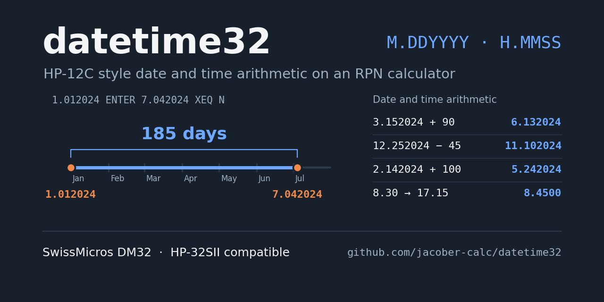
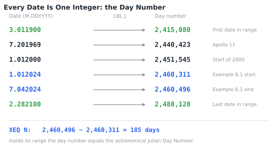
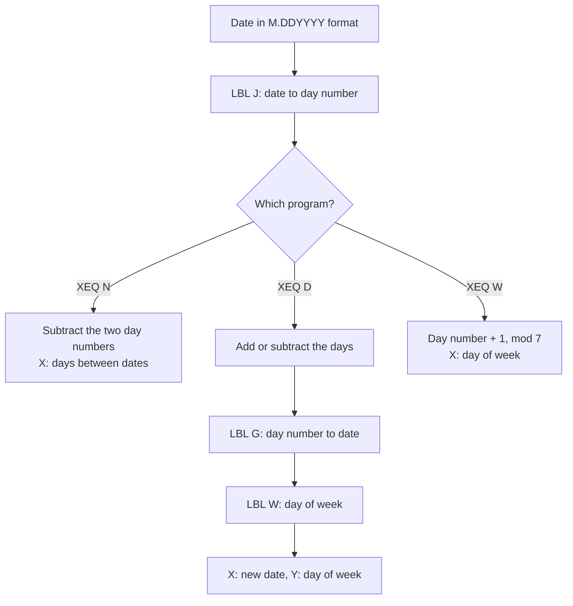
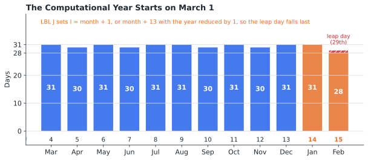
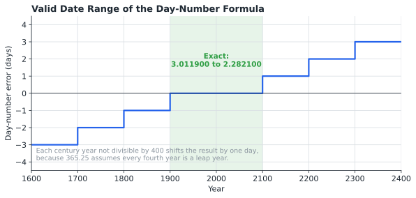
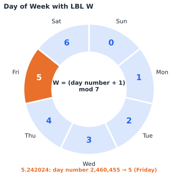
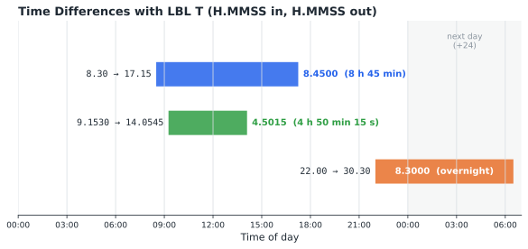
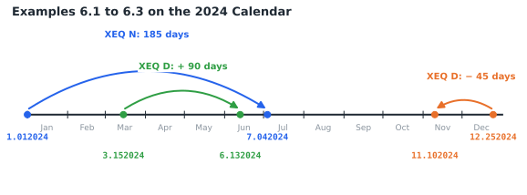

# datetime Statefile

## TABLE OF CONTENTS

1. [Introduction](#1-introduction)
2. [Theory of Operations](#2-theory-of-operations)
3. [Variable Definitions](#3-variable-definitions)
4. [Program Descriptions](#4-program-descriptions)
5. [Operating Instructions](#5-operating-instructions)
6. [Example Calculations](#6-example-calculations)
7. [Quick Reference](#7-quick-reference)
8. [Program Listing](#8-program-listing)

---

## 1. INTRODUCTION

This program suite provides date and time calculations for the SwissMicros DM32 calculator, replicating the date functions of the classic HP-12C financial calculator and adding a time-difference function.

### 1.1 Purpose

The program enables users to:

- Calculate the number of days between two dates
- Add or subtract days from a given date
- Determine the day of week for any date
- Calculate the time elapsed between two times of day

### 1.2 Date and Time Formats

All dates use the format **M.DDYYYY**:

- **M** = Month (1-12)
- **DD** = Day (01-31)
- **YYYY** = Year (four digits)

All times use the format **H.MMSS**, the same format used by the DM32's `→HR` and `→HMS` functions:

- **H** = Hours (0-23)
- **MM** = Minutes (00-59)
- **SS** = Seconds (00-59)

**Examples:**
- March 15, 2024 = `3.152024`
- December 25, 2025 = `12.252025`
- 5:15 PM = `17.15`
- 9:15:30 AM = `9.1530`

### 1.3 Valid Date Range

Dates from **March 1, 1900 (3.011900) through February 28, 2100 (2.282100)** are calculated exactly. See section 2.3.

### 1.4 System Requirements

SwissMicros DM32 calculator with RPN operating system. Program requires 176 program steps in 13 labels. No flags or equations are used.

The program uses only functions found on the HP-32SII and requires about 344 bytes including variables, so it can also be keyed into an HP-32SII from the listing in section 8. The Statefile itself loads only on the DM32.

### 1.5 Install and Download

Copy **DATETIME.d32** to the `/STATE` folder of the DM32's internal USB disk, then load it from the calculator. Instructions are available [via the DM32 User Manual](https://technical.swissmicros.com/dm32/doc/dm32_user_manual.html#_saving_and_loading_a_state).

---

## 2. THEORY OF OPERATIONS

### 2.1 Day Numbers

Every date calculation converts calendar dates into day numbers: a continuous count of days. Once dates are day numbers, the days between two dates is a subtraction, and adding days to a date is an addition. Within the valid range, the program's day number is the same as the astronomical Julian Day Number.



Every date program follows the same path:



### 2.2 Date-to-Day-Number Formula

LBL J splits the date into month, day, and year. January and February are treated as months 13 and 14 of the previous year, so the leap day falls at the end of the computational year and every other month keeps a fixed position. LBL F then applies the HP day-number formula:

```
Day number = IP(365.25 × y) + IP(30.6001 × I) + day + 1720982
```

Where y is the year (reduced by 1 for January and February) and I is the month + 1 (or the month + 13 for January and February). LBL C stores the three constants in B, D, and E.



LBL G reverses the formula. It recovers the year from the day number with 365.25, the month with 30.6001, and the day as the remainder, then LBL H assembles the result in M.DDYYYY format.

### 2.3 Valid Date Range

The factor 365.25 treats every fourth year as a leap year. The Gregorian calendar skips the leap day in century years not divisible by 400 (1700, 1800, 1900, 2100), so the formula is exact only between two of those skips: from March 1, 1900 through February 28, 2100. Each skipped century year outside the range shifts results by one day.



### 2.4 Day of Week and the Modulo Operation

The DM32 has no modulo function, so LBL M calculates the remainder as: `P - (IP(P/I) × I)`. LBL W adds 1 to the day number and takes the remainder after dividing by 7. The result runs from 0 for Sunday to 6 for Saturday.



### 2.5 Time Difference

LBL T converts both times from H.MMSS to decimal hours with `→HR`, subtracts the start from the end, and converts the result back with `→HMS`. Before converting back, it rounds the elapsed minutes with `RND`, which removes conversion error so that seconds come out exact.



---

## 3. VARIABLE DEFINITIONS

| Variable | Description |
|----------|-------------|
| **B** | Constant 365.25 (set by LBL C) |
| **D** | Constant 30.6001 (set by LBL C) |
| **E** | Constant 1720982 (set by LBL C) |
| **F** | Day of month (internal use) |
| **I** | Month index; divisor in LBL M (internal use) |
| **P** | Year; dividend in LBL M (internal use) |
| **N** | Stack value preserved by LBL J (internal use) |

---

## 4. PROGRAM DESCRIPTIONS

### 4.1 User Programs

#### LBL N - Days Between Dates (ΔDYS)

Calculates the number of days between two dates. Equivalent to the HP-12C ΔDYS function.

- **Inputs:** Date 1 (Y register), Date 2 (X register)
- **Output:** Days from Date 1 to Date 2 in the X register (negative if Date 2 is earlier)

#### LBL D - Date Arithmetic

Adds or subtracts days from a date. Equivalent to the HP-12C DATE function.

- **Inputs:** Date (Y register), Days (X register, negative for backward)
- **Outputs:** New date in M.DDYYYY format (X register), day of week (Y register)

#### LBL W - Day of Week

Returns the day of week for a date.

- **Input:** Date (X register)
- **Output:** Day of week in the X register (0 = Sunday through 6 = Saturday)

#### LBL T - Time Difference

Calculates the time elapsed between two times of day.

- **Inputs:** Start time (Y register), End time (X register), both in H.MMSS format
- **Output:** Elapsed time in H.MMSS format (X register)

### 4.2 Internal Subroutines

These are called by the user programs and should not be run directly:

- **LBL J:** Date to day number
- **LBL A, F:** Month index and day-number formula (part of LBL J)
- **LBL C:** Stores the day-number constants
- **LBL G:** Day number to date
- **LBL E, L, H:** Month, year correction, and M.DDYYYY assembly (part of LBL G)
- **LBL M:** Modulo (remainder) function

---

## 5. OPERATING INSTRUCTIONS

### 5.1 Days Between Two Dates (LBL N)

**Procedure:**
```
1. Enter first date (M.DDYYYY)
2. Press [ENTER]
3. Enter second date (M.DDYYYY)
4. Press [XEQ] [N]
```

**Result:** Number of days in the X register

### 5.2 Date Arithmetic (LBL D)

**Forward in time:**
```
1. Enter starting date (M.DDYYYY)
2. Press [ENTER]
3. Enter number of days
4. Press [XEQ] [D]
```

**Backward in time:**
```
1. Enter starting date (M.DDYYYY)
2. Press [ENTER]
3. Enter number of days
4. Press [+/-] to make negative
5. Press [XEQ] [D]
```

**Result:** New date in the X register; day of week in the Y register (press `[x<>y]` to view)

### 5.3 Day of Week (LBL W)

**Procedure:**
```
1. Enter date (M.DDYYYY)
2. Press [XEQ] [W]
```

**Result:** Day of week in the X register (0 = Sunday through 6 = Saturday)

### 5.4 Time Difference (LBL T)

**Procedure:**
```
1. Enter start time (H.MMSS)
2. Press [ENTER]
3. Enter end time (H.MMSS)
4. Press [XEQ] [T]
```

**Result:** Elapsed time in H.MMSS format in the X register

**Overnight:** If the end time is on the next day, add 24 to the end time before running LBL T (6:30 AM next day = `30.30`).

---

## 6. EXAMPLE CALCULATIONS



### 6.1 Days Between Dates

**Problem:** How many days between January 1, 2024 and July 4, 2024?

**Solution:**
```
1.012024 [ENTER] 7.042024 [XEQ] [N]
```

**Expected Result:** 185 days

### 6.2 Date Arithmetic - Forward

**Problem:** What date is 90 days after March 15, 2024?

**Solution:**
```
3.152024 [ENTER] 90 [XEQ] [D]
```

**Expected Result:** 6.132024 (June 13, 2024)

### 6.3 Date Arithmetic - Backward

**Problem:** What date was 45 days before December 25, 2024?

**Solution:**
```
12.252024 [ENTER] 45 [+/-] [XEQ] [D]
```

**Expected Result:** 11.102024 (November 10, 2024)

### 6.4 Date with Day of Week

**Problem:** What day of the week is 100 days after February 14, 2024?

**Solution:**
```
2.142024 [ENTER] 100 [XEQ] [D]
[x<>y]            (View day of week)
```

**Expected Results:**
- Date: 5.242024 (May 24, 2024)
- Day of Week: 5 (Friday)

### 6.5 Day of Week Directly

**Problem:** On what day of the week did July 20, 1969 fall?

**Solution:**
```
7.201969 [XEQ] [W]
```

**Expected Result:** 0 (Sunday)

### 6.6 Leap Year Testing

**Problem:** Verify leap year handling by calculating days in February 2024 and February 2000.

**Solution:**
```
2.012024 [ENTER] 3.012024 [XEQ] [N]
2.012000 [ENTER] 3.012000 [XEQ] [N]
```

**Expected Result:** 29 days for both (2024 is divisible by 4; 2000 is divisible by 400)

**Note:** February 1900 lies outside the valid range. The formula treats 1900 as a leap year and returns 29 days, although February 1900 had 28.

### 6.7 Days Since a Reference Date

**Problem:** How many days between the moon landing (July 20, 1969) and November 2, 2024?

**Solution:**
```
7.201969 [ENTER] 11.022024 [XEQ] [N]
```

**Expected Result:** 20,194 days

### 6.8 Time Difference

**Problem:** A shift starts at 8:30 AM and ends at 5:15 PM. How long is it?

**Solution:**
```
8.30 [ENTER] 17.15 [XEQ] [T]
```

**Expected Result:** 8.4500 (8 hours 45 minutes)

### 6.9 Time Difference with Seconds

**Problem:** How much time elapsed between 9:15:30 and 14:05:45?

**Solution:**
```
9.1530 [ENTER] 14.0545 [XEQ] [T]
```

**Expected Result:** 4.5015 (4 hours 50 minutes 15 seconds)

### 6.10 Overnight Time Difference

**Problem:** A shift starts at 10:00 PM and ends at 6:30 AM the next morning.

**Solution:**
```
22.00 [ENTER] 30.30 [XEQ] [T]
```

**Expected Result:** 8.3000 (8 hours 30 minutes). Entering 6.30 instead of 30.30 returns -15.3000.

---

## 7. QUICK REFERENCE

### 7.1 Function Summary

| Label | Function | Inputs | Output |
|-------|----------|--------|--------|
| **N** | Days between dates | Date1 [ENTER] Date2 | X: days |
| **D** | Date ± days | Date [ENTER] Days | X: date, Y: day of week |
| **W** | Day of week | Date | X: 0 (Sun) to 6 (Sat) |
| **T** | Time difference | Start [ENTER] End | X: H.MMSS |

### 7.2 Formats

- **Date:** M.DDYYYY (October 31, 2025 = `10.312025`)
- **Time:** H.MMSS (2:05:09 PM = `14.0509`)

### 7.3 Day of Week Numbers

| 0 | 1 | 2 | 3 | 4 | 5 | 6 |
|---|---|---|---|---|---|---|
| Sun | Mon | Tue | Wed | Thu | Fri | Sat |

### 7.4 Important Notes

- Dates are exact from 3.011900 through 2.282100; results outside this range are off by one day per skipped century leap year
- Dates must be entered in M.DDYYYY format with no separators between components
- Use `[+/-]` to make days negative for backward date arithmetic
- Times use H.MMSS format; for an overnight span, add 24 to the end time
- LBL T rounds with RND, which follows the display setting; FIX 6 (saved in the Statefile) gives exact seconds, while FIX 0 rounds to whole minutes
- The program does not check for invalid dates: 2.302024 is treated as 3.012024

---

## 8. PROGRAM LISTING

The complete program listing is provided below. Program steps are shown in standard DM32 RPN format with label-relative line numbers, as displayed on the calculator. The DM32 does not generate checksums.

### LBL T - Time Difference

```
T01  LBL T    Time difference. Y: start, X: end.
T02  →HR      End to decimal hours.
T03  x<>y
T04  →HR      Start to decimal hours.
T05  -        End − start.
T06  60
T07  ×        Minutes.
T08  RND      Rounds to display setting.
T09  60
T10  ÷        Back to hours.
T11  →HMS     Converts to H.MMSS.
T12  RTN      Returns elapsed time in X.
```

### LBL N - Days Between Dates

```
N01  LBL N    Days between dates. Y: date 1,
N02  XEQ J    X: date 2. Date 2 to day number.
N03  x<>y     Recalls date 1.
N04  XEQ J    Date 1 to day number.
N05  -        Day number 2 − day number 1.
N06  R↑       Clears the stack,
N07  CLx
N08  ENTER
N09  ENTER
N10  R↑       leaving days in X.
N11  RTN
```

### LBL D - Date Arithmetic

```
D01  LBL D    Date ± days. Y: date, X: days.
D02  x<>y
D03  XEQ J    Date to day number.
D04  +        Adds days.
D05  XEQ G    Day number to date.
D06  ENTER    Copies date.
D07  x<>y
D08  XEQ W    Day of week.
D09  x<>y     X: new date, Y: day of week.
D10  RTN
```

### LBL C - Day-Number Constants

```
C01  LBL C    Loads day-number constants.
C02  365.25   Days per year, B.
C03  STO B
C04  30.6001  Month factor, D.
C05  STO D
C06  1720982  Day-number offset, E.
C07  STO E
C08  RTN
```

### LBL J - Date to Day Number

```
J01  LBL J    Date to day number. X: M.DDYYYY.
J02  x<>y     Saves the other stack value
J03  STO N    in N.
J04  R↓
J05  ENTER
J06  IP       Month.
J07  STO I    Stored in I.
J08  R↓
J09  FP
J10  100
J11  ×        DD.YYYY.
J12  ENTER
J13  IP       Day.
J14  STO F    Stored in F.
J15  R↓
J16  FP
J17  4
J18  10ˣ
J19  ×        Year.
J20  STO P    Stored in P.
J21  RCL I
J22  2
J23  x<y?     Month after February?
J24  GTO A    If so, I = month + 1.
J25  13
J26  STO+ I   January or February: I = month + 13,
J27  1
J28  STO- P   year − 1.
J29  GTO F
```

### LBL A - Month Index, March to December

```
A01  LBL A    March to December.
A02  1
A03  STO+ I   I = month + 1.
```

### LBL F - Day-Number Formula

```
F01  LBL F    Day-number formula.
F02  XEQ C    Loads constants.
F03  RCL P
F04  RCL B
F05  ×
F06  IP       IP(365.25 × year).
F07  RCL I
F08  RCL D
F09  ×
F10  IP       IP(30.6001 × I).
F11  +
F12  RCL F
F13  +        + day.
F14  RCL E
F15  +        + 1720982.
F16  RCL N
F17  x<>y     X: day number, Y: saved value.
F18  RTN
```

### LBL G - Day Number to Date

```
G01  LBL G    Day number to date.
G02  RCL E
G03  -
G04  STO F    F = day number − E.
G05  122
G06  -
G07  10
G08  1/x
G09  -        F − 122.1.
G10  RCL B
G11  ÷
G12  IP       Year.
G13  STO P    Stored in P.
G14  RCL B
G15  ×
G16  IP
G17  +/-
G18  RCL F
G19  +        Days into year.
G20  RCL D
G21  ÷
G22  IP       Month index.
G23  STO I    Stored in I.
G24  RCL D
G25  ×
G26  IP
G27  RCL P
G28  RCL B
G29  ×
G30  IP
G31  +
G32  +/-
G33  RCL F
G34  +        Day of month.
G35  STO F    Stored in F.
G36  14
G37  RCL I
G38  x<y?     I below 14?
G39  GTO E    If so, month = I − 1.
G40  13
G41  STO- I   Otherwise month = I − 13.
G42  GTO L
```

### LBL E - Month from Index

```
E01  LBL E    Month = I − 1.
E02  1
E03  STO- I
```

### LBL L - Year Correction

```
L01  LBL L    Year correction.
L02  RCL I
L03  2
L04  x<y?     Month after February?
L05  GTO H
L06  1
L07  STO+ P   January or February: year + 1.
```

### LBL H - Build M.DDYYYY

```
H01  LBL H    Builds M.DDYYYY.
H02  RCL P
H03  6
H04  10ˣ
H05  ÷        Year ÷ 10⁶.
H06  RCL F
H07  100
H08  ÷        Day ÷ 100.
H09  +
H10  RCL I
H11  +        + month.
H12  FIX 6    Restores display.
H13  RTN      Returns date in X.
```

### LBL M - Modulo Function

```
M01  LBL M    Modulo. Y: dividend, X: divisor.
M02  STO I    Divisor.
M03  x<>y
M04  STO P    Dividend.
M05  x<>y
M06  ÷
M07  IP       IP(dividend ÷ divisor).
M08  RCL I
M09  ×
M10  RCL P
M11  x<>y
M12  -        Remainder.
M13  RTN
```

### LBL W - Day of Week

```
W01  LBL W    Day of week. X: date.
W02  XEQ J    Date to day number.
W03  1
W04  +        Day number + 1.
W05  7
W06  XEQ M    Mod 7.
W07  RTN      0 = Sunday to 6 = Saturday.
```

---

## Disclaimer

This program suite is provided as-is for educational and personal use.

### By jacober-calc for SwissMicros DM32

> - [SwissMicros Website](https://www.swissmicros.com)
> - [DM32 product page](https://www.swissmicros.com/en/products/dm32)
> - [SwissMicros full products page](https://www.swissmicros.com/en/shop)
> - [DM32 Online User Manual](https://technical.swissmicros.com/dm32/doc/dm32_user_manual.html)
> - [SwissMicros Calculator Forum](https://forum.swissmicros.com/index.php)
